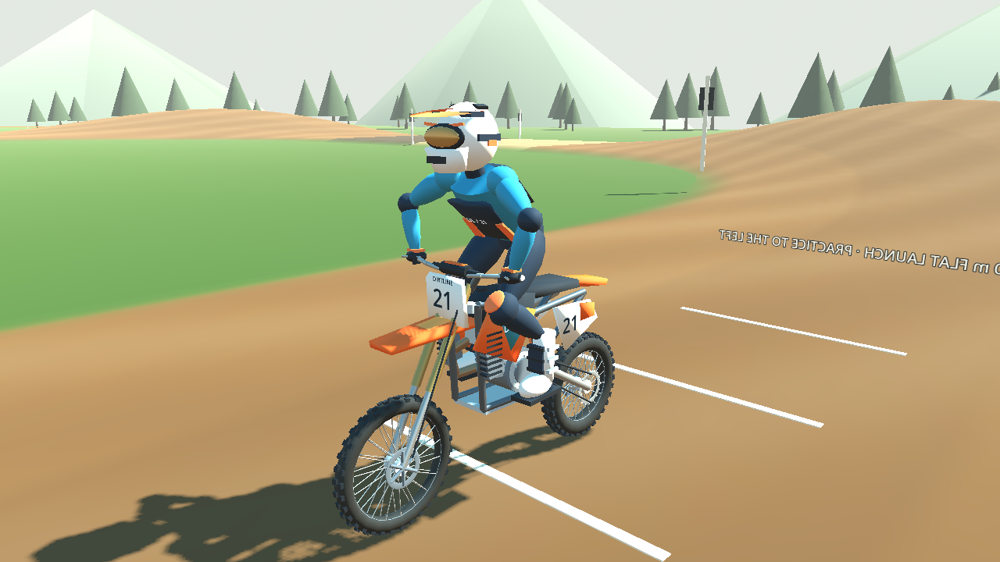

# Dirtline MX

A standalone Windows motocross simulation prototype, built with Godot 4.6.3 and Jolt Physics. Version 0.3 improves balance over rough ground, smooths lean commands, retunes suspension and adds an articulated motocross riding stance. Helmet view and customizable controller bindings are included.



## Play on Windows

1. [Download Dirtline MX v0.3.0 for Windows](https://github.com/Ceeb68/Roblox/raw/refs/heads/main/downloads/DirtlineMX-Windows-v0.3.0.zip).
2. Right-click the ZIP and choose **Extract All**.
3. Open the extracted folder and double-click **DirtlineMX.exe**. Keep its `.pck` file beside it.
4. The bike starts in neutral with the clutch pulled and feet down. Press **E** for first, hold **W** to build revs, then hold **B** to release the clutch gradually. Raise your feet with **F** once moving.

Use **A/D** or the left stick to request bike lean; the virtual rider countersteers through the handlebars. **Z/X** moves the rider's upper body. Use **M / controller B** for first-person helmet view, **H** for help and **U** for suspension setup. Open **Escape / Start → Settings + controller binds → Controller bindings** to customize buttons, axes, inversion and deadzones. Preferences are saved on your computer. No Roblox installation or game editor is needed to play.

If you previously selected manual handlebars, choose **Virtual rider** in Settings to use the updated lean control.

After a crash, bike and rider remount automatically after **one second** near the crash site. **R / controller Y** remounts immediately. Recovery resets the rider's physical and visible pose, selects neutral, plants feet and clears movement; release any held controls before using them again. Unsafe ground falls back to the lab spawn.

## First prototype

The larger proving ground has a 40 m flat launch, a separate 100 m practice straight, 10 m wide track, 30 m corners, berms, ruts, braking bumps, whoops, a tabletop, a large-jump lane and surface test pads. Native wheel bodies and suspension joints provide collision and support; custom tire/drivetrain models supply grip, slip, clutch, manual gears, braking and engine reactions. Default virtual-rider control uses finite, physical countersteering to balance and follow your lean command. Fully manual handlebars remain selectable. The bike's pose is never locked upright, and airborne landing orientation is not corrected.

This is an early physics prototype. Numerical and native-engine tests establish specific behaviors; they do not establish MX Bikes-level riding quality. Calibration, human obstacle acceptance, tire/soil detail and production art remain work in progress. Windows desktop execution must also be checked on a Windows PC; the cloud development machine runs Linux.

[Research notes](standalone/MX_BIKES_RESEARCH.md) distinguish published vehicle-dynamics findings from our engineering choices. Official MX Bikes pages were blocked by the cloud network policy, so this build makes no claims about its proprietary settings or code.

| Action | Keyboard |
| --- | --- |
| Throttle / front brake / rear brake | W / Space / S |
| Pull / release clutch | V / B; Shift quick pull |
| Shift down / up | Q / E |
| Bike lean command / rider lean | A–D / Z–X |
| Rider forward–back / side | I–K / J–L |
| Standing / feet | C / F |
| Recover / engine starter | R / T |
| Help / suspension setup | H / U |
| Chase / first-person camera | M; controller B / Circle |

## Develop

```bash
cd /workspace/Roblox
bash standalone/tools/setup.sh
bash standalone/tools/check.sh
bash standalone/tools/export.sh
```

Open `standalone/project.godot` in Godot 4.6.3 to edit or ride. See [standalone documentation](standalone/README.md) for the physics architecture, controller mapping, build instructions and current validation.

The GitHub repository retains its original name. The new game lives entirely in `standalone/` and has no Roblox dependency. The earlier Roblox prototype is preserved in history and [legacy documentation](docs/ROBLOX_LEGACY.md).
