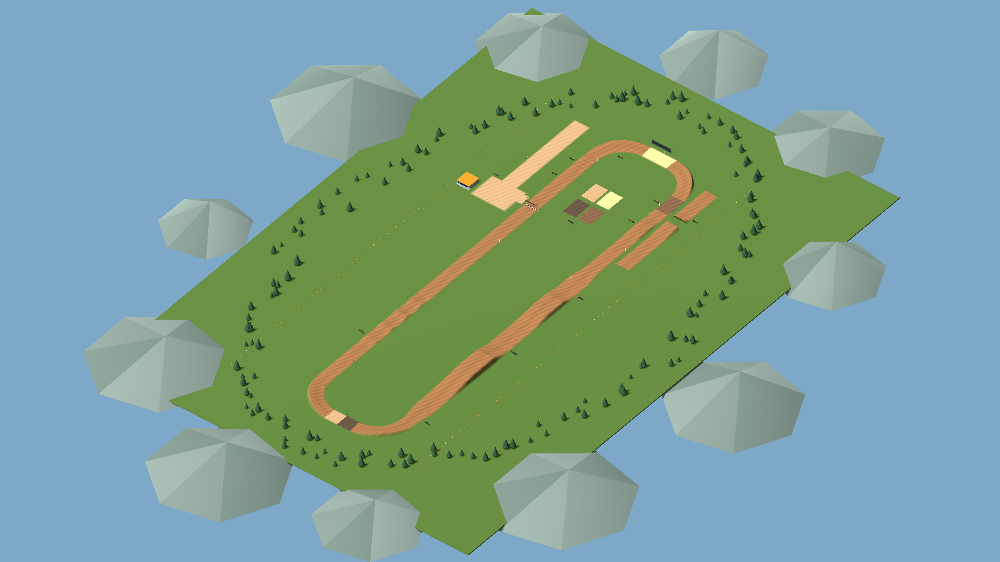

# Dirtline MX

A standalone Windows motocross game prototype, built with Godot 4.6.3 and Jolt Physics. Version 0.6 rebuilds tire response, deliberate lean control, airborne rotation and suspension damping, adds a physical jump scrub, and blends the rider's cornering legs and body continuously. The handling target is roughly 75% simulation and 25% forgiveness. The 873 m circuit, helmet view, automatic recovery and customizable controller bindings are included.


## Play on Windows

1. [Download Dirtline MX v0.6.0 for Windows](https://github.com/Ceeb68/Roblox/raw/refs/heads/main/downloads/DirtlineMX-Windows-v0.6.0.zip).
2. Right-click the ZIP and choose **Extract All**.
3. Open the extracted folder and double-click **DirtlineMX.exe**. Keep its `.pck` file beside it.
4. The bike starts in neutral with the clutch pulled and feet down. Press **E** for first, hold **W** to build revs, then hold **B** to release the clutch gradually. Feet lift automatically during launch and plant when you stop.

Use **A/D** or the left stick to request bike lean; the virtual rider countersteers through the handlebars. **Z/X** moves the rider's upper body independently. In the air, use the left stick for roll and the right stick for pitch/yaw; counter-input returns a whip. Hold **F / controller X** while leaning on an ascending jump face to scrub. Use **M / controller B** for helmet view, **H** for help and **U** for suspension setup. Open **Escape / Start → Settings + controller binds → Controller bindings** to customize controls. No Roblox installation or game editor is needed to play.

If you previously selected manual handlebars, choose **Virtual rider** in Settings to use the updated lean control.

After a crash, bike and rider remount automatically after **one second** near the crash site. **R / controller Y** remounts immediately. Recovery resets the rider's physical and visible pose, selects neutral, plants feet and clears movement; release any held controls before using them again. Unsafe ground falls back to the lab spawn.

## First prototype



The 873 m proving circuit has a 40 m flat launch, a separate 100 m practice straight, berms, ruts, bumps, whoops, and 3.2 m and 4.5 m tabletops. Five independent native bodies model the frame, rider, fork and wheels. Custom tire/drivetrain models supply grip, slip, clutch, manual gears, braking and engine reactions. Default virtual-rider handling adds bounded low-speed balance and airborne rotation assistance to the physical simulation. It never assigns the bike's pose or chooses a landing heading. Fully manual handlebars remain selectable.

This is an early physics prototype. Numerical and native-engine tests establish specific behaviors; they do not establish MX Bikes-level riding quality. Calibration, human obstacle acceptance, tire/soil detail and production art remain work in progress. Windows desktop execution must also be checked on a Windows PC; the cloud development machine runs Linux.

[Research notes](standalone/MX_BIKES_RESEARCH.md) distinguish published vehicle-dynamics findings from our original game-assistance choices. [Handling validation](standalone/VALIDATION.md) records actual native riding tests and their limits. No proprietary MX Bikes or MX Simulator code, physics engine or assets are used.

| Action | Keyboard |
| --- | --- |
| Throttle / front brake / rear brake | W / Space / S |
| Pull / release clutch | V / B; Shift quick pull |
| Shift down / up | Q / E |
| Bike lean command / rider lean | A–D / Z–X |
| Rider forward–back / side | I–K / J–L |
| Standing / seated | C |
| Scrub on an ascending jump face | Hold F; controller X |
| Recover / engine starter | R / T |
| Help / suspension setup | H / U |
| Chase / first-person camera | M; controller B / Circle |

## Develop

```bash
cd /workspace/Roblox
bash standalone/tools/setup.sh
bash standalone/tools/check.sh
bash standalone/tools/export.sh
```

Open `standalone/project.godot` in Godot 4.6.3 to edit or ride. See [standalone documentation](standalone/README.md) for the physics architecture, controller mapping, build instructions and current validation.

The GitHub repository retains its original name. The new game lives entirely in `standalone/` and has no Roblox dependency. The earlier Roblox prototype is preserved in history and [legacy documentation](docs/ROBLOX_LEGACY.md).
